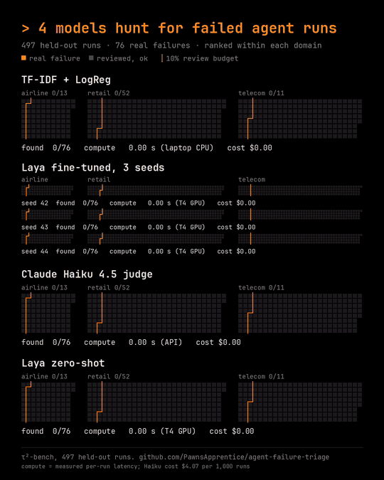
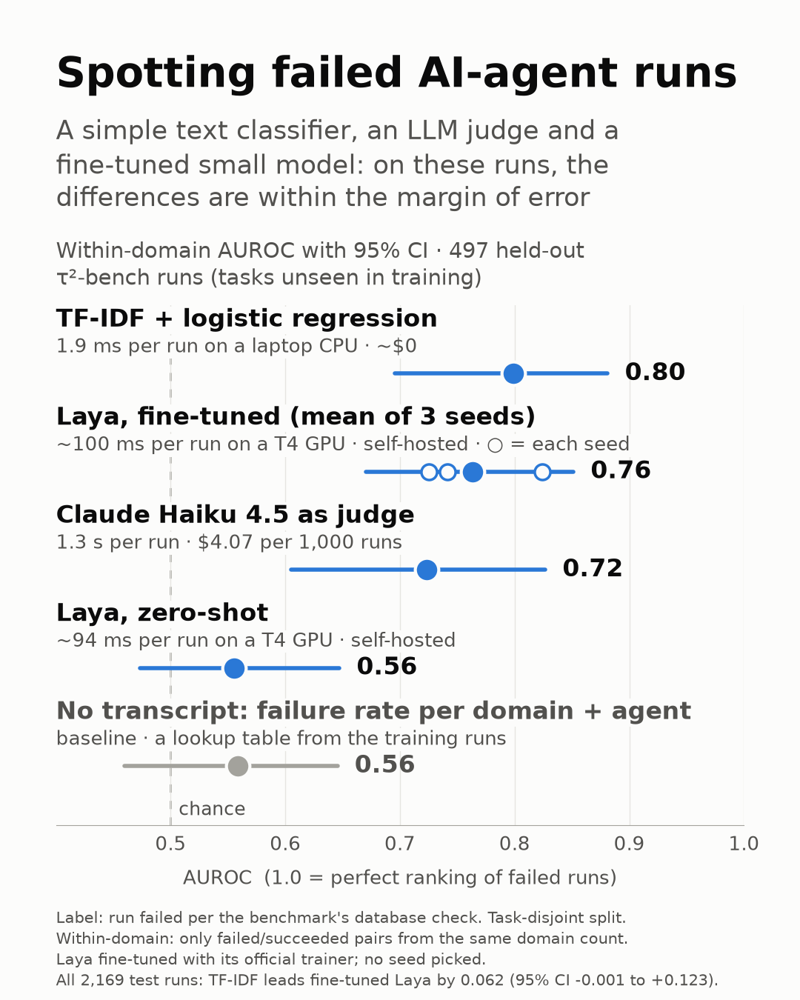

# agent-failure-triage

**Can Laya replace an LLM judge for flagging failed agent runs? Zero-shot, no. Fine-tuned Laya
is not clearly better than the LLM judge, and it trails a free 1.9 ms TF-IDF model on the full
test split, so it is not worth the extra cost on this data.**

Within-domain AUROC compares failed and successful runs from the same domain only. Pooled
across domains, the numbers look more decisive (TF-IDF 0.84, Haiku 0.70), but a lookup table of
domain and agent failure rates, which never reads a transcript, already scores 0.69 pooled.

The chart and the animation use the 497 test runs that the LLM judge scored, so they are the
place to compare models with Haiku: there, every within-domain difference among TF-IDF,
fine-tuned Laya and Haiku is within the margin of error. TF-IDF and fine-tuned Laya were both scored on all 2,169
test runs, and that is where to compare those two: TF-IDF leads the mean of the three
fine-tuned seeds by 0.065 pooled AUROC (95% CI +0.021 to +0.109) and by 0.062 within domain
(−0.001 to +0.123). The 497 sample flatters fine-tuned Laya (0.764 within domain, against 0.729
on the full split).

- **[`tau2/`](tau2/): the main experiment.** Can Laya replace an LLM judge for flagging failed
  agent runs? Labels come from τ²-bench's database check, the split is task-disjoint, and all
  four models are evaluated with decision rules fixed in advance. Methods, full tables, the three
  fine-tuning seeds and the caveats are in [`tau2/README.md`](tau2/README.md).
- **[`bgl/`](bgl/): an earlier, abandoned attempt** on BlueGene/L system logs. BGL's labels were
  system alert tags rather than triage decisions, and the logs were out of domain for Laya, so the
  experiment couldn't answer the question.

Shared code (metrics, the Laya wrapper, plotting) is in `common/`. `laya_check/` reproduces Laya's
published accuracy, as a check of our harness before any experiment.

Code is MIT-licensed (see `LICENSE`), except `tau2/kaggle/train_ddp_laya.py`. That file is a
modified copy of Laya's official trainer and stays under Apache-2.0. Third-party data is not
redistributed; the scripts download it. See the license sections in each experiment's README.
